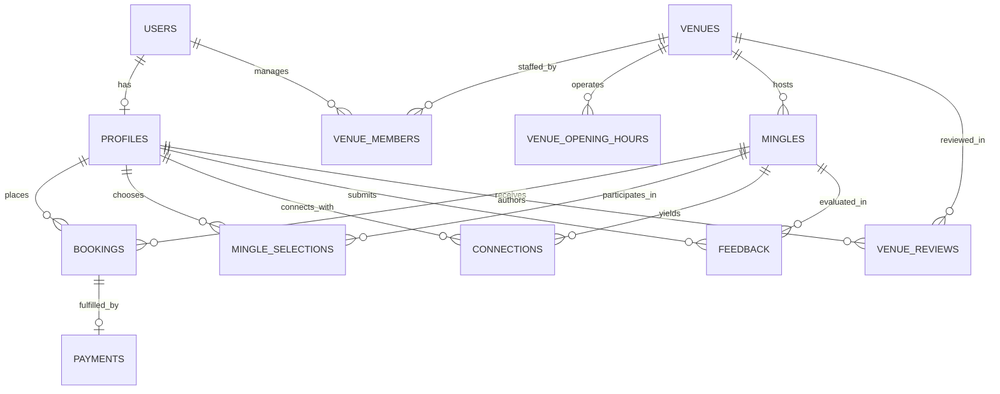

# Backend Engineering Development Plan: Django DRF + PostgreSQL (3NF)

**Project:** Mingler (`mingler.co.uk`) — Custom Dedicated Backend  
**Framework:** Python 3.12, Django 5.1, Django REST Framework (DRF) 3.15  
**Database:** PostgreSQL 16 (Strict Third Normal Form - 3NF)  
**Lead Systems Architect:** Biplob Hussain  
**Date:** October 2026  

---

## Table of Contents
1. [Backend Architectural Overview & Directory Hierarchy](#1-backend-architectural-overview--directory-hierarchy)
2. [Database Design in Third Normal Form (3NF)](#2-database-design-in-third-normal-form-3nf)
   - 2.1 [Core Entities & Relationships (ERD)](#21-core-entities--relationships-erd)
   - 2.2 [Django ORM Models Specification](#22-django-orm-models-specification)
   - 2.3 [Database Constraints & Index Optimization](#23-database-constraints--index-optimization)
3. [Authentication, Authorization & Role-Based Access Control (RBAC)](#3-authentication-authorization--role-based-access-control-rbac)
   - 3.1 [SimpleJWT Token Lifecycle](#31-simplejwt-token-lifecycle)
   - 3.2 [User Roles & Permissions Matrix](#32-user-roles--permissions-matrix)
   - 3.3 [Custom DRF Permission Classes](#33-custom-drf-permission-classes)
4. [Secure Payment Handling & Idempotency Engine](#4-secure-payment-handling--idempotency-engine)
   - 4.1 [Stripe Checkout Session Architecture](#41-stripe-checkout-session-architecture)
   - 4.2 [Atomic Concurrency Lock on Ticket Reservations](#42-atomic-concurrency-lock-on-ticket-reservations)
   - 4.3 [Webhook Signature Verification & Idempotent Processing](#43-webhook-signature-verification--idempotent-processing)
5. [RESTful API Endpoints Specification](#5-restful-api-endpoints-specification)
6. [Asynchronous Background Tasks & Notification Engine](#6-asynchronous-background-tasks--notification-engine)
   - 6.1 [Celery & Redis Worker Setup](#61-celery--redis-worker-setup)
   - 6.2 [Scheduled Beat Jobs (Reminders & Review Prompts)](#62-scheduled-beat-jobs-reminders--review-prompts)
7. [Step-by-Step AI-DLC Development Milestones & Verification Gates](#7-step-by-step-ai-dlc-development-milestones--verification-gates)

---

The backend is built following clean modular monolith architecture with Django apps organized around specific business domains:

### 1.1 Technology Stack & Infrastructure Choices
* **Language & Framework:** Python 3.12, Django 5.1, Django REST Framework (DRF) 3.15
* **Relational Database:** PostgreSQL 16
* **Database Driver & ORM:** `psycopg[binary]`, Django ORM with strict foreign keys and transactional locking
* **Authentication:** `djangorestframework-simplejwt` (Access & Refresh tokens with rotation and blacklisting)
* **Asynchronous Jobs & Scheduling:** Celery 5.4, Redis 7.2, `django-celery-beat`
* **Payment Processing:** `stripe` Python SDK (Stripe Checkout Sessions, Webhooks, Idempotency)
* **Media & File Storage:** **Cloudflare R2** (S3-compatible API via `django-storages` & `boto3`, zero egress bandwidth fees, 10GB free tier)
* **Transactional Email:** **Gmail SMTP via Client's Google App Password** (`django.core.mail.backends.smtp.EmailBackend` via `smtp.gmail.com:587` with TLS)
* **Containerization:** **Docker & Docker Compose** multi-container setup (web, celery-worker, celery-beat, redis, postgres). Staging deployment via **Render** Docker service; live production via dedicated **Linux VPS**.
* **API Documentation:** `drf-spectacular` (OpenAPI 3.0 / Swagger UI)

### 1.2 Directory Hierarchy

```
backend/
├── config/
│   ├── settings/
│   │   ├── base.py              # Common database, apps, DRF configuration
│   │   ├── local.py             # Development environment overrides
│   │   └── production.py        # Cloud environment (AWS/Render/Docker, SSL, Sentry)
│   ├── urls.py                  # API router aggregation & Swagger docs
│   ├── wsgi.py                  # Production WSGI application
│   └── celery.py                # Celery app initialization & task auto-discovery
├── apps/
│   ├── core/                    # Abstract BaseModel (UUID, created_at, updated_at), common pagination, error handlers
│   ├── users/                   # Custom User model (email as username), Profile, UK GDPR age verification
│   ├── venues/                  # Venue directory, VenueOpeningHours, VenueMembers relations
│   ├── mingles/                 # Mingle experience catalog, category filtering, lifecycle management
│   ├── bookings/                # Reservations, concurrency locks, capacity math, ticket records
│   ├── payments/                # Stripe API service, Webhooks, Idempotency tracking, financial ledger
│   ├── interactions/            # Post-Mingle reviews, Mutual matching algorithm, Celebration state
│   ├── notifications/           # Celery email dispatchers, MJML templates, .ics calendar attachments
│   └── administration/          # Curator review queue, platform fee historical rate points, admin metrics
├── tests/                       # Pytest test suite (unit, integration, concurrency)
├── manage.py
├── requirements/
│   ├── base.txt
│   ├── local.txt
│   └── production.txt
└── Dockerfile
```

---

## 2. Database Design in Third Normal Form (3NF)

### 2.1 Core Entities & Relationships (ERD)



### 2.2 Django ORM Models Specification

#### App: `apps.users`
```python
class User(AbstractBaseUser, PermissionsMixin):
    ROLE_CHOICES = (
        ('member', 'Member'),
        ('venue_manager', 'Venue Manager'),
        ('admin', 'Platform Admin'),
    )
    id = models.UUIDField(primary_key=True, default=uuid.uuid4, editable=False)
    email = models.EmailField(unique=True, db_index=True)
    role = models.CharField(max_length=20, choices=ROLE_CHOICES, default='member')
    is_active = models.BooleanField(default=True)
    is_staff = models.BooleanField(default=False)
    created_at = models.DateTimeField(auto_now_add=True)

class Profile(models.Model):
    GENDER_CHOICES = (('Male', 'Male'), ('Female', 'Female'), ('Prefer not to say', 'Prefer not to say'))
    RELATIONSHIP_CHOICES = (('Single', 'Single'), ('Married', 'Married'), ("It's complicated", "It's complicated"))
    
    id = models.UUIDField(primary_key=True, default=uuid.uuid4, editable=False)
    user = models.OneToOneField(User, on_delete=models.CASCADE, related_name='profile')
    display_name = models.CharField(max_length=100)
    photo = models.URLField(max_length=500, blank=True)
    gender = models.CharField(max_length=25, choices=GENDER_CHOICES, blank=True)
    relationship_status = models.CharField(max_length=25, choices=RELATIONSHIP_CHOICES, blank=True)
    date_of_birth = models.DateField(null=True, blank=True, help_text="UK GDPR Private - Never exposed publicly")
    is_age_verified = models.BooleanField(default=False)
    bio = models.TextField(blank=True)
    interests = models.JSONField(default=list, blank=True)
    instagram_handle = models.CharField(max_length=50, blank=True)
    linkedin_url = models.URLField(max_length=200, blank=True)
    sound_enabled = models.BooleanField(default=True)
    notifications_enabled = models.BooleanField(default=True)
```

#### App: `apps.venues`
```python
class Venue(models.Model):
    STATUS_CHOICES = (('pending', 'Pending Approval'), ('approved', 'Approved'), ('rejected', 'Rejected'))
    
    id = models.UUIDField(primary_key=True, default=uuid.uuid4, editable=False)
    name = models.CharField(max_length=150)
    slug = models.SlugField(max_length=160, unique=True)
    category = models.CharField(max_length=50)
    area = models.CharField(max_length=100)
    address = models.CharField(max_length=255)
    postcode = models.CharField(max_length=20)
    description = models.TextField()
    hero_image = models.URLField(max_length=500)
    status = models.CharField(max_length=20, choices=STATUS_CHOICES, default='pending')
    commission_rate = models.DecimalField(max_digits=5, decimal_places=2, default=10.00)
    created_at = models.DateTimeField(auto_now_add=True)

class VenueOpeningHour(models.Model):
    DAY_CHOICES = [(i, day) for i, day in enumerate(['Monday', 'Tuesday', 'Wednesday', 'Thursday', 'Friday', 'Saturday', 'Sunday'])]
    
    venue = models.ForeignKey(Venue, on_delete=models.CASCADE, related_name='opening_hours')
    day_of_week = models.IntegerField(choices=DAY_CHOICES)
    open_time = models.TimeField(null=True, blank=True)
    close_time = models.TimeField(null=True, blank=True)
    is_closed = models.BooleanField(default=False)

    class Meta:
        unique_together = ('venue', 'day_of_week')
```

#### App: `apps.mingles` & `apps.bookings`
```python
class Mingle(models.Model):
    STATUS_CHOICES = (
        ('draft', 'Draft'),
        ('submitted', 'Submitted for Review'),
        ('changes_requested', 'Changes Requested'),
        ('approved', 'Approved'),
        ('published', 'Published Live'),
        ('completed', 'Completed'),
        ('cancelled', 'Cancelled')
    )
    id = models.UUIDField(primary_key=True, default=uuid.uuid4, editable=False)
    venue = models.ForeignKey(Venue, on_delete=models.PROTECT, related_name='mingles')
    title = models.CharField(max_length=150)
    experience_type = models.CharField(max_length=50)
    event_date = models.DateField(db_index=True)
    start_time = models.TimeField()
    duration_minutes = models.IntegerField(default=120)
    ticket_price = models.DecimalField(max_digits=8, decimal_places=2)
    capacity = models.PositiveIntegerField(validators=[MinValueValidator(1)])
    age_min = models.PositiveIntegerField(default=18)
    age_max = models.PositiveIntegerField(default=99)
    hero_image = models.URLField(max_length=500)
    status = models.CharField(max_length=25, choices=STATUS_CHOICES, default='draft')
    curator_notes = models.TextField(blank=True)
    created_at = models.DateTimeField(auto_now_add=True)

class Booking(models.Model):
    STATUS_CHOICES = (('pending', 'Pending Payment'), ('confirmed', 'Confirmed'), ('cancelled', 'Cancelled'), ('refunded', 'Refunded'))
    
    id = models.UUIDField(primary_key=True, default=uuid.uuid4, editable=False)
    mingle = models.ForeignKey(Mingle, on_delete=models.CASCADE, related_name='bookings')
    profile = models.ForeignKey('users.Profile', on_delete=models.PROTECT, related_name='bookings')
    places_booked = models.PositiveSmallIntegerField(default=1, validators=[MinValueValidator(1), MaxValueValidator(5)])
    unit_price = models.DecimalField(max_digits=8, decimal_places=2)
    total_amount = models.DecimalField(max_digits=8, decimal_places=2)
    status = models.CharField(max_length=20, choices=STATUS_CHOICES, default='pending')
    created_at = models.DateTimeField(auto_now_add=True)

    class Meta:
        constraints = [
            models.CheckConstraint(check=models.Q(places_booked__gte=1, places_booked__lte=5), name='valid_places_range')
        ]
```

---

## 3. Authentication, Authorization & Role-Based Access Control (RBAC)

### 3.1 SimpleJWT Token Lifecycle & Email Verification
* **Email Verification Engine:**
  - Upon registration, an unverified user account (`is_email_verified = False`) is created and a cryptographically generated 6-digit OTP code (`EmailVerificationCode`) valid for 15 minutes is dispatched via transactional email.
  - Verification endpoint (`POST /api/v1/auth/verify-email/`) validates the code, marks `is_email_verified = True`, and returns active JWT tokens.
  - Resend endpoint (`POST /api/v1/auth/resend-verification/`) generates a fresh OTP with a 60-second cooldown rate limit.
* **Access Token:** 15 minutes validity. Included in `Authorization: Bearer <token>` header.
* **Refresh Token:** 7 days validity. Secure rotation enabled (`ROTATE_REFRESH_TOKENS = True`, `BLACKLIST_AFTER_ROTATION = True`).
* **UK GDPR Sanitization Middleware:** Excludes `date_of_birth` and `email` from all public serializations.

### 3.2 Custom DRF Permission Classes (`apps.core.permissions`)
```python
from rest_framework import permissions

class IsPlatformAdmin(permissions.BasePermission):
    def has_permission(self, request, view):
        return bool(request.user and request.user.is_authenticated and request.user.role == 'admin')

class IsVenueManager(permissions.BasePermission):
    def has_permission(self, request, view):
        return bool(request.user and request.user.is_authenticated and request.user.role in ['venue_manager', 'admin'])

class HasConfirmedAttendanceForReview(permissions.BasePermission):
    def has_object_permission(self, request, view, obj):
        # Checks if user has a confirmed booking for this mingle
        return Booking.objects.filter(
            mingle=obj, 
            profile=request.user.profile, 
            status='confirmed'
        ).exists()
```

---

## 4. Secure Payment Handling & Idempotency Engine

### 4.1 Concurrency Lock on Booking Creation (`apps.bookings.services`)
To prevent overbooking when the final seat is contested:
```python
from django.db import transaction
from django.core.exceptions import ValidationError
from django.db.models import Sum

@transaction.atomic
def reserve_places_and_create_stripe_session(mingle_id, profile, num_places):
    # Lock row until transaction completes
    mingle = Mingle.objects.select_for_update().get(id=mingle_id)

    # Date guard (Defect 3)
    if mingle.event_date < timezone.now().date():
        raise ValidationError("Registration is closed for past events.")

    # Capacity calculation
    booked_count = Booking.objects.filter(
        mingle=mingle, status='confirmed'
    ).aggregate(total=Sum('places_booked'))['total'] or 0

    if booked_count + num_places > mingle.capacity:
        raise ValidationError("Not enough seats available.")

    # Create pending booking
    booking = Booking.objects.create(
        mingle=mingle,
        profile=profile,
        places_booked=num_places,
        unit_price=mingle.ticket_price,
        total_amount=mingle.ticket_price * num_places,
        status='pending'
    )

    # Initialize Stripe session
    session = stripe.checkout.Session.create(
        payment_method_types=['card'],
        currency='gbp',
        line_items=[{
            'price_data': {
                'currency': 'gbp',
                'product_data': {'name': f"Mingler: {mingle.title}"},
                'unit_amount': int(mingle.ticket_price * 100),
            },
            'quantity': num_places,
        }],
        mode='payment',
        success_url=f"{settings.FRONTEND_URL}/booking-success?session_id={{CHECKOUT_SESSION_ID}}",
        cancel_url=f"{settings.FRONTEND_URL}/checkout/{mingle.id}?cancelled=true",
        client_reference_id=str(booking.id),
        metadata={'booking_id': str(booking.id), 'mingle_id': str(mingle.id)}
    )
    return session.url
```

### 4.2 Webhook Idempotency Receiver (`apps.payments.views`)
```python
@csrf_exempt
def stripe_webhook(request):
    payload = request.body
    sig_header = request.META.get('HTTP_STRIPE_SIGNATURE')

    try:
        event = stripe.Webhook.construct_event(payload, sig_header, settings.STRIPE_WEBHOOK_SECRET)
    except (ValueError, stripe.error.SignatureVerificationError):
        return HttpResponse(status=400)

    # Replay protection
    if StripePaymentEvent.objects.filter(event_id=event['id']).exists():
        return HttpResponse(status=200)

    if event['type'] == 'checkout.session.completed':
        session = event['data']['object']
        booking_id = session['metadata']['booking_id']

        with transaction.atomic():
            booking = Booking.objects.select_for_update().get(id=booking_id)
            booking.status = 'confirmed'
            booking.save()

            Payment.objects.create(
                booking=booking,
                stripe_checkout_session_id=session['id'],
                stripe_payment_intent_id=session['payment_intent'],
                amount_paid=session['amount_total'] / 100,
                currency='GBP',
                payment_status='succeeded'
            )
            StripePaymentEvent.objects.create(event_id=event['id'], event_type=event['type'])

            # Async trigger ticket & calendar email
            send_booking_confirmation_email.delay(str(booking.id))

    return HttpResponse(status=200)
```

---

## 5. RESTful API Endpoints Specification

* `POST /api/v1/auth/register/` — New member registration (triggers 6-digit OTP email).
* `POST /api/v1/auth/verify-email/` — Verify 6-digit OTP code & activate account.
* `POST /api/v1/auth/resend-verification/` — Resend 6-digit OTP with 60s cooldown.
* `POST /api/v1/auth/login/` — Token acquisition (email + password).
* `POST /api/v1/auth/token/refresh/` — Access token refresh.
* `POST /api/v1/auth/logout/` — Blacklist refresh token.
* `GET /api/v1/profiles/me/` — Retrieve private profile.
* `PATCH /api/v1/profiles/me/` — Update profile & socials.
* `GET /api/v1/profiles/public/?ids=...` — Sanitized attendee profiles (no PII).
* `GET /api/v1/mingles/` — Filterable catalogue of published mingles.
* `GET /api/v1/mingles/{id}/` — Single mingle details with live seat counts.
* `GET /api/v1/mingles/{id}/attendees/` — Dynamic list of confirmed attendees.
* `POST /api/v1/bookings/initiate/` — Reserve seats and obtain Stripe checkout URL.
* `GET /api/v1/bookings/my-bookings/` — List user's past and upcoming tickets.
* `POST /api/v1/payments/webhook/` — Stripe signed webhook handler.
* `GET /api/v1/interactions/after-mingle/{id}/` — Eligible peer attendees for matching.
* `POST /api/v1/interactions/after-mingle/{id}/submit/` — Submit reviews & mutual picks.
* `GET /api/v1/venues/` — Approved venue directory.
* `GET /api/v1/venues/{id}/` — Single venue details with dynamic aggregated reviews.
* `POST /api/v1/venue-portal/submissions/` — Venue staff drafts a new mingle.
* `GET /api/v1/admin/approvals/` — Founder queue of pending mingles and venues.
* `POST /api/v1/admin/approvals/{id}/action/` — Founder approves, rejects, or requests changes.
* `PATCH /api/v1/admin/platform-settings/` — Update commission fee with audit log.

---

## 6. Asynchronous Background Tasks & Notification Engine

* **Celery Task 1: `send_booking_confirmation_email(booking_id)`**  
  Renders responsive HTML template, attaches `.ics` iCalendar file, and dispatches via SMTP.
* **Celery Task 2: `evaluate_mutual_connections(mingle_id, selector_id, target_ids)`**  
  Evaluates bidirectional picks. If mutual match occurs, creates `Connection` and dispatches `send_connection_celebration_email` to both members.
* **Celery Beat Schedule:**
  - Every day at 08:00 AM: `send_24h_mingle_reminders()` to attendees of tomorrow's events.
  - Every day at 09:00 AM: `send_after_mingle_review_prompts()` to attendees of yesterday's completed events.

---

## 7. Step-by-Step AI-DLC Development Milestones & Verification Gates

1. **Milestone B1 (Core Models & 3NF Database Migrations):**
   - Create models with strict constraints and generate initial migrations.
   - *Verification:* Run `python manage.py test apps.core apps.users apps.mingles`.
2. **Milestone B2 (Auth & UK GDPR Privacy Lockdown):**
   - Implement SimpleJWT and public profile sanitization serializer.
   - *Verification:* Verify `verified_dob` is never present in `/api/v1/profiles/public/`.
3. **Milestone B3 (Mingle Catalog & Concurrency Booking):**
   - Implement catalog filters and `select_for_update()` ticket reservation logic.
   - *Verification:* Concurrency unit test simulating simultaneous checkout on the last seat.
4. **Milestone B4 (Stripe Integration & Idempotent Webhook):**
   - Implement checkout session and webhook receiver with replay defense.
   - *Verification:* Execute Stripe CLI mock events (`stripe trigger checkout.session.completed`).
5. **Milestone B5 (Interactions, Mutual Matching & Celery Email Worker):**
   - Implement review submission, mutual matching calculation, and Celery tasks.
   - *Verification:* Unit test confirming bidirectional selections create a `Connection` record.
